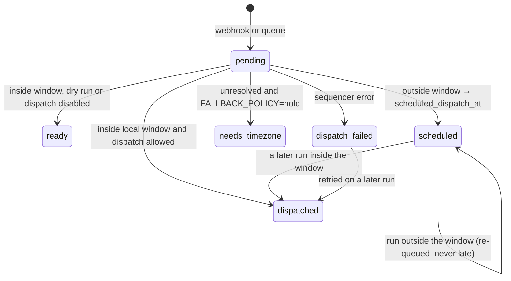

<div align="center">

# n8n-outbound-lead-time-zone-optimal-dispatch-scheduler

**Smart scheduling pipeline that evaluates recipient phone or email timezones and queues outbound dispatches exclusively during local business hours (9 AM – 5 PM).**

A dhRobin Systems Revenue Infrastructure blueprint

     

</div>

---

## Table of Contents

1. [Overview](#1-overview)
2. [Architecture and Data Flow](#2-architecture-and-data-flow)
3. [Repository Contents](#3-repository-contents)
4. [Prerequisites](#4-prerequisites)
5. [5-Minute Sandbox Quick Start](#5-5-minute-sandbox-quick-start)
6. [Step-by-Step Import and Configuration Guide](#6-step-by-step-import-and-configuration-guide)
7. [Environment Variables](#7-environment-variables)
8. [Node-by-Node Configuration Guide](#8-node-by-node-configuration-guide)
9. [Timezone Resolution Hierarchy and Business-Hours Logic](#9-timezone-resolution-hierarchy-and-business-hours-logic)
10. [Safety Matrix](#10-safety-matrix)
11. [Data Protection and Compliance Checklist](#11-data-protection-and-compliance-checklist)
12. [Operations and Troubleshooting](#12-operations-and-troubleshooting)
13. [Disclaimer and License](#13-disclaimer-and-license)

---

## 1. Overview

An email that lands at 3 AM sits under a morning's worth of newer mail, and a call at 7 PM reaches voicemail or an annoyed prospect. Most sequencers schedule in the *sender's* timezone, or in one timezone per campaign, so a list that spans New York, London and Sydney is always wrong for two-thirds of it.

I built this scheduler to decide per lead. It works out each recipient's timezone from the strongest available evidence: an explicit IANA field, then the phone number's country and area code, then country/region fields, then the email domain's country TLD, then a fallback. It then computes the recipient's local time and weekday. A lead inside the local window (9:00–17:00 by default) is dispatched now. Any other lead gets the exact next valid `scheduled_dispatch_at`, skipping weekends, regional Friday–Saturday weekends and holidays, and correct across daylight-saving changes. A scheduled run every 15 minutes picks queued leads up as their windows open.

**Design principles**

| Principle | Implementation |
|---|---|
| Safe by default | With no environment variables set, the workflow makes **no external calls, dispatches nothing and writes nothing**. Dispatch requires `SANDBOX_MODE=false`, `DRY_RUN=false` **and** `DISPATCH_ENABLED=true`. |
| Never late | A due lead whose local window has closed is re-queued for the next slot, never sent late. |
| Evidence over guessing | Each lead records *how* its timezone was resolved (`timezone_method`) and how sure the workflow is (`timezone_confidence`). With `FALLBACK_POLICY=hold`, unresolved leads are held instead of guessed. |
| DST-correct | Local wall-clock times are converted to UTC through the built-in `Intl` API, re-checking the offset on the target date. Tests cover the US, UK, EU and Australian DST changes against Python's `zoneinfo`. |
| No double sends | Dispatch batches carry an `Idempotency-Key`. Dispatched lead IDs are remembered for `DEDUPE_HOURS` in production runs, even if the queue update fails. |
| Minimal data out | Only `lead_id`, contact points, channel, timezone fields and the lead's own `payload` object go to the sequencer. Slack, webhook and audit carry lead IDs and timezones, never emails or phone numbers. |
| Secrets out of data | Tokens and URLs appear only as `{{ $env.* }}` in HTTP URL and header fields. The one documented exception is the inbound webhook token ([§8.2](#82-load--normalize-leads)). |

---

## 2. Architecture and Data Flow

```mermaid
flowchart LR
    WH[Inbound Lead Webhook<br/>POST /outbound/leads/schedule] --> CFG
    SCH[Queue Evaluation Schedule<br/>every 15 min] --> CFG
    MAN[Manual Test Trigger] --> CFG[Config & Safety Gate]
    CFG --> FW{From Webhook?}
    FW -- yes --> LD
    FW -- no --> SB{Sandbox Mode?}
    SB -- yes --> LD
    SB -- no --> QF[Queue: Fetch Pending Leads] --> LD
    LD[Load & Normalize Leads<br/>token check · validate · DNC · dedupe] --> HL{Has Leads?}
    HL -- no --> AUD
    HL -- yes --> EV[Timezone Resolution &<br/>Business-Hours Evaluation]
    EV --> RT[Route & Build Dispatch Batches<br/>dispatch_now · defer · hold]
    RT --> DG{Dispatch Gate<br/>!sandbox · !dry run · DISPATCH_ENABLED}
    DG -- yes --> EB[Emit Dispatch Batches] --> DS[Dispatch: Send Batch] --> CD[Collect Dispatch Results] --> QU
    DG -- no --> QU[Build Queue Updates]
    QU --> QW{Queue Write?}
    QW -- yes --> QP[Queue: Update Lead Status] --> NOTE
    QW -- no --> NOTE[Build Notification]
    NOTE --> NT{Notify?}
    NT -- no --> AUD
    NT -- yes --> SE{Slack Enabled?}
    SE -- yes --> SL[Slack: Post Summary] --> WE
    SE -- no --> WE{Webhook Enabled?}
    WE -- yes --> WB[Webhook: Post Summary] --> AUD
    WE -- no --> AUD[Execution Summary & Audit]
```



### Lead lifecycle



### Stage contracts

| Stage | Output shape |
|---|---|
| Load & Normalize Leads | `{ source, auth, received, count, leads: [{ leadId, email, phone, timezone, country, region, channel, scheduledDispatchAt, payload }], rejected[] }` |
| Timezone Resolution & Business-Hours Evaluation | `{ evaluatedAt, window, counts{ leads, dispatch_now, defer, hold }, leads: [{ …lead, resolvedTimezone, resolution{ method, confidence, tried[] }, localTime, weekday, utcOffset, inWindow, decision, reason, scheduledDispatchAt, scheduledLocal, waitMinutes }] }` |
| Route & Build Dispatch Batches | Same, plus `batches[{ batchId, leadIds[], body }]`, `dispatchAllowed`, `dispatchCount` |
| Collect Dispatch Results | `{ results[{ batchId, leads, ok, error }], dispatched[], failed[] }` |
| Build Queue Updates | `{ updates[{ lead_id, status, timezone, timezone_method, timezone_confidence, scheduled_dispatch_at, … }], statusCounts, queueWriteAllowed }` |
| Execution Summary & Audit | Outcome, safety flags, window, source, rejected leads, per-lead decision with presence flags instead of contact data, dispatch, queue and notification results |

---

## 3. Repository Contents

```
n8n-outbound-lead-time-zone-optimal-dispatch-scheduler/
├── README.md                     Technical documentation (this file)
├── workflow.json                 Importable n8n workflow with sticky notes and pinned synthetic payloads
├── DISCLAIMER.md                 Liability limitation and usage terms
├── LICENSE                       MIT License
└── sample-payloads/
    └── queued-leads.json         Synthetic leads across timezones (also embedded in the sandbox loader)
```

All names, emails, IDs and phone numbers in these files are fictitious. Phone numbers use ranges reserved for fiction (`+1-202-555-01xx`, `+44-20-7946-0xxx`, `+61-2-5550-xxxx`).

---

## 4. Prerequisites

| Requirement | Detail |
|---|---|
| n8n | Self-hosted **1.60 or later** (Webhook 2, Schedule Trigger 1.2, Set 3.4, IF 2, Code 2, HTTP Request 4.2, `$('Node').isExecuted`, `v1` execution order). |
| Env access | `N8N_BLOCK_ENV_ACCESS_IN_NODE=false`, so `{{ $env.* }}` expressions resolve. |
| Crypto in Code nodes | `NODE_FUNCTION_ALLOW_BUILTIN=crypto` for the inbound webhook token check. Timezone maths needs no modules. |
| Full ICU | The official n8n images ship Node.js with full ICU, which `Intl` timezone support needs. On a custom build, check that `new Intl.DateTimeFormat('en-US', { timeZone: 'Australia/Sydney' })` works. |
| Lead queue (scheduled path) | An HTTP endpoint that returns pending leads and accepts status updates (contract in [§8.2](#82-load--normalize-leads) and [§8.6](#86-queue-update)). This can be a CRM list API behind a small adapter, a database API, or an n8n Data Table/webhook pair. |
| Dispatcher | A sequencer, dialer or messaging intake endpoint that accepts a JSON batch ([§8.5](#85-dispatch)). |
| Slack / webhook (optional) | An incoming webhook URL, and/or any JSON endpoint. |

> **n8n Cloud:** you can't define your own environment variables there, and Code nodes can't load `crypto`. Replace `$env.X` with `$vars.X` (on plans with Variables), and set `REQUIRE_WEBHOOK_TOKEN=false` only if the webhook is protected another way (for example, a reverse proxy).

---

## 5. 5-Minute Sandbox Quick Start

1. **Run n8n locally:**
   ```bash
   docker run -it --rm -p 5678:5678 \
     -e N8N_BLOCK_ENV_ACCESS_IN_NODE=false \
     -e NODE_FUNCTION_ALLOW_BUILTIN=crypto \
     -e GENERIC_TIMEZONE=UTC \
     -e EVALUATION_TIME_OVERRIDE=2026-11-16T15:30:00Z \
     -v n8n_data:/home/node/.n8n \
     docker.n8n.io/n8nio/n8n
   ```
   `EVALUATION_TIME_OVERRIDE` freezes "now" so the result below is reproducible. It's honoured only in sandbox or dry run. Leave it out to evaluate against the real clock.
2. **Import** `workflow.json` (*Workflows → Import from File*).
3. Click **Test workflow** on *Manual Test Trigger*.
4. Open **Timezone Resolution & Business-Hours Evaluation** and **Execution Summary & Audit**.

**Expected sandbox result** at Monday 16 Nov 2026, 15:30 UTC (window 09:00–17:00, weekends skipped, fallback `America/New_York`):

| Lead | Evidence | Timezone (method · confidence) | Local time | Decision |
|---|---|---|---|---|
| `lead_id_1001` | `+1-202-555-0148` | America/New_York (area code 202 · high) | Mon 10:30 | ✅ dispatch now |
| `lead_id_1002` | `+1 (415) 555-0123` | America/Los_Angeles (area code 415 · high) | Mon 07:30 | 🕒 Mon 09:00 −08:00 |
| `lead_id_1003` | `+44-20-7946-0921` | Europe/London (+44 · high) | Mon 15:30 | ✅ dispatch now |
| `lead_id_1004` | `+61 2 5550 1234` | Australia/Sydney (AU area 2 · medium) | Tue 02:30 | 🕒 Tue 09:00 +11:00 |
| `lead_id_1005` | `@example.com` only | America/New_York (**fallback**) | Mon 10:30 | ✅ dispatch now (or ⏸️ held with `FALLBACK_POLICY=hold`) |
| `lead_id_1006` | `timezone: Asia/Tokyo` | Asia/Tokyo (explicit · high) | Tue 00:30 | 🕒 Tue 09:00 +09:00 |
| `lead_id_1007` | invalid `Mars/Olympus_Mons`, `@example.de` | Europe/Berlin (ccTLD .de · low) | Mon 16:30 | ✅ dispatch now |
| `lead_id_1008` | `+1-999-…` (unknown area code), `US`/`CO` | America/Denver (country/region · medium) | Mon 08:30 | 🕒 Mon 09:00 −07:00 |
| `lead_id_1009` | `country: SA` | Asia/Riyadh (country · medium) | Mon 18:30 | 🕒 Tue 09:00 +03:00 |

Rejected by the loader: `lead_id_1010` (do not contact), a duplicate `lead_id_1001`, and a lead without `lead_id`. Outcome: `dispatchable_sandbox`, with 4 leads `ready` and 5 `scheduled`. Re-run with `EVALUATION_TIME_OVERRIDE=2026-11-20T22:30:00Z` (Friday evening in New York) to see weekend rollover to Monday, and Saudi Arabia's Friday–Saturday weekend rolling over to Sunday.

---

## 6. Step-by-Step Import and Configuration Guide

Each step changes one thing and has an exit check.

| Step | Configuration | Exit check |
|---|---|---|
| **1. Import and sandbox** | Defaults (+ `EVALUATION_TIME_OVERRIDE` for a fixed result) | The table in [§5](#5-5-minute-sandbox-quick-start) is reproduced. |
| **2. Tune the window** | `BUSINESS_START_HOUR`, `BUSINESS_END_HOUR` (`9`, `9:30`, `17`), `END_BUFFER_MINUTES`, `WEEKEND_DAYS`, `HOLIDAYS`, `FALLBACK_TIMEZONE` / `FALLBACK_POLICY` | Slots match your policy for several override times, including a Friday evening and a DST weekend. |
| **3. Pinned live path** | `SANDBOX_MODE=false`, `DRY_RUN=false`, `DISPATCH_ENABLED=true`, any `QUEUE_API_URL`, `QUEUE_UPDATE_URL`, `DISPATCH_WEBHOOK_URL`, `NOTIFY_CHANNELS=slack,webhook`, any `SLACK_WEBHOOK_URL` / `ALERT_WEBHOOK_URL`. Run **Test workflow** | Every node runs on pinned synthetic responses (`outcome: dispatched` during a window that includes some fixture leads). Nothing leaves n8n. |
| **4. Queue reads, dry run** | Unpin *Queue: Fetch Pending Leads* (*right-click → Unpin*). Real `QUEUE_API_URL`, `CRM_API_KEY`, `DRY_RUN=true` | *Evaluation* shows your queued leads with sensible timezones. Inspect every `fallback` and `low` result. |
| **5. Queue write-back** | Unpin *Queue: Update Lead Status*. `DRY_RUN=false`, `DISPATCH_ENABLED=false`, `QUEUE_UPDATE_URL` | Your queue stores `scheduled_dispatch_at` and `status` (`ready` / `scheduled` / `needs_timezone`). Outcome `dispatchable_dispatch_disabled`. |
| **6. Dispatch to a test sequence** | Unpin *Dispatch: Send Batch*. `DISPATCH_ENABLED=true`, `DISPATCH_WEBHOOK_URL` pointing at a test sequence or a request bin you control | Only leads inside their local window arrive, with `timezone`, `local_time` and `Idempotency-Key`. |
| **7. Inbound webhook** | `WEBHOOK_SHARED_TOKEN`, `REQUIRE_WEBHOOK_TOKEN=true`. Point your form or CRM workflow at the **production** URL with `Authorization: Bearer <token>`, then activate the workflow | A lead posted at 23:00 recipient time is queued for 09:00 (next business day). A lead posted at 11:00 is dispatched immediately. |
| **8. Production** | Slack in a team channel. Monitor `needs_timezone` and `dispatch_failed` counts | The schedule drains the queue as windows open around the world. |

---

## 7. Environment Variables

All variables are optional. Unset values resolve to the safest behaviour.

### 7.1 Safety gate

| Variable | Default | Effect |
|---|---|---|
| `SANDBOX_MODE` | `true` | Synthetic leads for manual and scheduled runs. No queue, dispatch or notification calls. Webhook bodies are still evaluated but never dispatched. |
| `DRY_RUN` | `true` | Evaluation and payloads only. No dispatch, no queue write. |
| `DISPATCH_ENABLED` | `false` | Explicit opt-in for calling the dispatch webhook. |
| `QUEUE_WRITEBACK_ENABLED` | `true` | Write statuses back to `QUEUE_UPDATE_URL` (effective only with sandbox and dry run off and the URL set). |
| `EVALUATION_TIME_OVERRIDE` | — | ISO timestamp used as "now". **Ignored unless sandbox or dry run is on.** |

### 7.2 Business window

| Variable | Default | Effect |
|---|---|---|
| `BUSINESS_START_HOUR` | `9` | Local start, `H` or `H:MM` (inclusive). |
| `BUSINESS_END_HOUR` | `17` | Local end, `H` or `H:MM` (exclusive). Must be later than the start. |
| `END_BUFFER_MINUTES` | `0` (0–240) | Stop immediate dispatch this many minutes before the end, for sequencers that deliver with a delay. |
| `SKIP_WEEKENDS` | `true` | Skip weekend days. |
| `WEEKEND_DAYS` | `sat,sun` | Weekend days (three-letter names). |
| `REGIONAL_WEEKENDS` | `true` | Use a Friday–Saturday weekend for Israel, Saudi Arabia, Qatar, Kuwait, Bahrain, Oman and Egypt. |
| `HOLIDAYS` | — | Comma-separated `YYYY-MM-DD` dates, applied to the **recipient's local date**. |
| `SPREAD_MINUTES` | `0` (0–240) | Spread deferred slots over this many minutes after the window opens (deterministic per lead), so a queue doesn't fire all at once at exactly 09:00. |

### 7.3 Timezone resolution

| Variable | Default | Effect |
|---|---|---|
| `FALLBACK_TIMEZONE` | `America/New_York` | Zone for leads with no usable evidence. Must be a valid IANA name. |
| `FALLBACK_POLICY` | `use_fallback` | `use_fallback` or `hold` (unresolved leads get `needs_timezone` and are never dispatched). |

### 7.4 Sources, dispatch and limits

| Variable | Default | Effect |
|---|---|---|
| `QUEUE_API_URL` 🔒 | — | `GET` endpoint for pending leads. |
| `QUEUE_UPDATE_URL` 🔒 | — | `POST` endpoint for status updates. |
| `CRM_API_KEY` 🔒 | — | Bearer token for both queue endpoints. |
| `DISPATCH_WEBHOOK_URL` 🔒 | — | Sequencer / dialer intake endpoint. |
| `DISPATCH_API_TOKEN` 🔒 | — | Bearer token for the dispatch endpoint. |
| `DISPATCH_BATCH_SIZE` | `50` (1–500) | Leads per dispatch request. |
| `MAX_LEADS_PER_RUN` | `500` (1–5000) | Cap per run. Also sent as `limit` to the queue. |
| `DEDUPE_HOURS` | `24` | Production-only memory of dispatched lead IDs. |
| `WEBHOOK_SHARED_TOKEN` 🔒 | — | Token expected on the inbound webhook (`Authorization: Bearer …` or `X-Webhook-Token`). |
| `REQUIRE_WEBHOOK_TOKEN` | `true` | Reject inbound requests without a valid token outside sandbox. |

### 7.5 Notifications

| Variable | Default | Effect |
|---|---|---|
| `NOTIFY_CHANNELS` | `slack` | `slack`, `webhook` or both. A channel is active only when its URL is set. |
| `SLACK_WEBHOOK_URL` 🔒 | — | Slack incoming webhook. |
| `ALERT_WEBHOOK_URL` 🔒 | — | Generic JSON webhook. |
| `ALERT_WEBHOOK_TOKEN` 🔒 | — | Bearer token for the alert webhook. |
| `NOTIFY_ON_EVERY_RUN` | `false` | By default, notifications go out only when something was dispatched, failed or held. |

🔒 = secret (endpoints included). Inject from a secret manager, never commit.

### 7.6 Sample `.env` (staging)

```bash
# n8n runtime
N8N_BLOCK_ENV_ACCESS_IN_NODE=false
NODE_FUNCTION_ALLOW_BUILTIN=crypto

# Safety gate: live queue reads and write-back, no dispatch yet
SANDBOX_MODE=false
DRY_RUN=false
DISPATCH_ENABLED=false

# Business window (recipient local time)
BUSINESS_START_HOUR=9
BUSINESS_END_HOUR=17
END_BUFFER_MINUTES=15
SKIP_WEEKENDS=true
WEEKEND_DAYS=sat,sun
HOLIDAYS=2026-12-25,2027-01-01
SPREAD_MINUTES=30

# Timezone fallback
FALLBACK_TIMEZONE=America/New_York
FALLBACK_POLICY=hold

# Endpoints and secrets (inject from your secret manager; never commit)
QUEUE_API_URL=
QUEUE_UPDATE_URL=
CRM_API_KEY=
DISPATCH_WEBHOOK_URL=
DISPATCH_API_TOKEN=
WEBHOOK_SHARED_TOKEN=
SLACK_WEBHOOK_URL=
```

---

## 8. Node-by-Node Configuration Guide

### 8.1 Triggers and Config & Safety Gate

- **Inbound Lead Webhook** (`POST /webhook/outbound/leads/schedule`) answers `202` immediately and accepts one lead, an array, or `{ "leads": [...] }`.
- **Queue Evaluation Schedule** runs every 15 minutes. A lead scheduled for 09:00 is dispatched by the first run at or after 09:00, so dispatch happens within 15 minutes of the slot.
- **Config & Safety Gate** parses the window into minutes, validates enums and lists, and sets `queueWriteEnabled` and the channel flags. It records only whether an endpoint is set, never the URL itself.

### 8.2 Load & Normalize Leads

**Queue contract (`GET {QUEUE_API_URL}?status=pending&due_before=<now ISO>&limit=<n>`):** returns `{ "leads": [...] }`, `{ "data": [...] }` or a top-level array. Lead fields:

| Field | Required | Meaning |
|---|---|---|
| `lead_id` (or `id`) | yes | Stable identifier, used for de-duplication and idempotency |
| `email`, `phone` | one of them | Contact points. Phones in E.164 (`+…`) resolve best. |
| `timezone` / `time_zone` / `tz` | no | IANA name, e.g. `Europe/London` |
| `country` / `country_code`, `region` / `state` | no | ISO-3166 alpha-2 country, state/province code |
| `channel` | no | `email` (default), `phone`, `sms`, … (passed through) |
| `do_not_contact` | no | `true` → rejected |
| `scheduled_dispatch_at` | no | Previous slot (informational; the slot is always recomputed) |
| `payload` | no | Object passed through unchanged to the dispatcher (e.g. `sequence_id`) |

**Validation:** missing `lead_id`, no contact point, `do_not_contact`, duplicates within the batch, leads dispatched within `DEDUPE_HOURS` (production runs) and leads beyond `MAX_LEADS_PER_RUN` are listed in `rejected`.

**Webhook token (documented exception):** n8n's built-in webhook header authentication needs a stored credential, so this Code node reads `WEBHOOK_SHARED_TOKEN` in memory. It compares SHA-256 digests in constant time and never writes the token to its output.

### 8.3 Timezone Resolution & Business-Hours Evaluation

Implements [§9](#9-timezone-resolution-hierarchy-and-business-hours-logic). Every lead gets `resolvedTimezone`, `resolution.method`, `resolution.confidence`, `resolution.tried` (the evidence that didn't resolve, e.g. `explicit_iana_invalid:Mars/Olympus_Mons`), `localTime` (ISO with offset), `weekday`, `decision` and `reason`. Deferred leads also get `scheduledDispatchAt` (UTC ISO), `scheduledLocal` and `waitMinutes`.

### 8.4 Route & Build Dispatch Batches

Splits leads into `dispatch_now`, `defer` and `hold`, and builds dispatch batches of `DISPATCH_BATCH_SIZE`. `dispatchAllowed` is true only when sandbox and dry run are off and `DISPATCH_ENABLED=true`.

### 8.5 Dispatch

`POST {DISPATCH_WEBHOOK_URL}` with `Authorization: Bearer {DISPATCH_API_TOKEN}` and `Idempotency-Key: <batch_id>`:

```json
{
  "batch_id": "1234-1",
  "generated_at": "2026-11-16T15:30:00.000Z",
  "leads": [
    { "lead_id": "lead_id_1003", "email": "priya.shah@example.co.uk", "phone": "+44-20-7946-0921", "channel": "email",
      "timezone": "Europe/London", "timezone_method": "phone_country_code:+44", "timezone_confidence": "high",
      "local_time": "2026-11-16T15:30:00+00:00", "dispatch_at": "2026-11-16T15:30:00.000Z",
      "payload": { "sequence_id": "seq_demo_02" } }
  ]
}
```

Any 2xx counts as accepted. Errors are kept per batch (`continueRegularOutput`). Leads in a failed batch become `dispatch_failed` and are retried by the next run, still only inside their window.

### 8.6 Queue update

`POST {QUEUE_UPDATE_URL}` with `{ "updates": [...] }`, one entry per evaluated lead:

| `status` | Extra fields | Meaning |
|---|---|---|
| `dispatched` | `dispatched_at` | Accepted by the dispatcher |
| `scheduled` | `scheduled_dispatch_at`, `scheduled_local_time`, `defer_reason` | Outside the window. Return it from the queue once `due_before` passes. |
| `ready` | `scheduled_dispatch_at` | Inside the window, but dispatch disabled or dry run |
| `dispatch_failed` | `scheduled_dispatch_at` | Dispatcher error. Keep it pending. |
| `needs_timezone` | `hold_reason` | Unresolved with `FALLBACK_POLICY=hold`. Fix the lead data. |

Every entry also carries `timezone`, `timezone_method`, `timezone_confidence` and `evaluated_at`. Your queue should return `scheduled`, `ready` and `dispatch_failed` leads as `pending` once their `scheduled_dispatch_at` has passed.

### 8.7 Notifications and audit

**Build Notification** creates one Slack message (mode, window, counts, the next 10 slots in recipient local time, held lead IDs, dispatch and queue failures, distribution by timezone) and one webhook document (`event: "outbound.dispatch_scheduler.run"`). It sends only when something was dispatched, failed or held, unless `NOTIFY_ON_EVERY_RUN=true`.

**Execution Summary & Audit** outcomes: `no_leads`, `no_dispatchable_leads`, `all_leads_queued`, `dispatchable_sandbox`, `dispatchable_dry_run`, `dispatchable_dispatch_disabled`, `dispatched`, `dispatched_partially`, `dispatch_failed`. Contact points appear only as `hasEmail` / `hasPhone`.

---

## 9. Timezone Resolution Hierarchy and Business-Hours Logic

### 9.1 Resolution hierarchy (first hit wins)

| # | Evidence | Rule | Confidence |
|:-:|---|---|:-:|
| 1 | `timezone` / `time_zone` / `tz` | Accepted if `Intl` recognises the IANA name. An invalid name is recorded in `tried` and resolution continues. | high |
| 2a | Phone `+1` (NANP) | Area code → zone table (US, Canada, Puerto Rico; 322 area codes, including Arizona's no-DST zone and Saskatchewan). Unknown area codes continue down the list. | high |
| 2b | Phone, single-zone country code | `+44` London, `+49` Berlin, `+91` Kolkata, `+81` Tokyo, `+971` Dubai, … (56 calling codes). Longest prefix wins. | high |
| 2c | Phone, multi-zone country | `+61` 2 → Sydney, 3 → Melbourne, 7 → Brisbane (8 and mobiles 4 are ambiguous and continue). `+55` area 1x–5x → São Paulo. `+52` → Mexico City. | medium |
| 3 | `country` (+ `region`) | Single-zone countries directly. US, CA, AU, MX and BR need a region (state/province). | medium |
| 4 | Email domain ccTLD | `.uk` London, `.de` Berlin, `.in` Kolkata, … Multi-zone ccTLDs (`.au`, `.ca`, `.br`, `.mx`) use the most populous zone. Generic TLDs (`.com`, `.io`, `.co`, …) are skipped. | low |
| 5 | Fallback | `FALLBACK_TIMEZONE`, or hold with `FALLBACK_POLICY=hold` | fallback |

Phone numbers are normalised by removing punctuation, and a `00` international prefix is converted to `+`. Numbers without a country prefix aren't guessed (`phone_not_e164`).

> **Known limits:** mobile numbers travel with their owners, area codes that straddle a timezone boundary are mapped to the zone of their main population, and states split across zones (for example, parts of Indiana, Kentucky, Tennessee and Texas) use the state's majority zone. Store an explicit `timezone` on the lead whenever you know it. It always wins.

### 9.2 Business-hours evaluation

For the resolved zone, at "now":

1. Compute local date, time and weekday with `Intl.DateTimeFormat`.
2. A lead is **inside the window** when the local day is a business day (not a weekend day, not in `HOLIDAYS`) and `BUSINESS_START_HOUR ≤ local time < BUSINESS_END_HOUR − END_BUFFER_MINUTES`. It's dispatched now.
3. Otherwise the **next slot** is the window start (plus the lead's spread offset) on the first business day at or after today whose start is still in the future. The reason is recorded as `before_business_hours`, `after_business_hours`, `weekend` or `holiday`.
4. The local slot is converted to UTC with a two-pass offset calculation, so slots across DST changes are exact. For example, a slot on Monday 9 March 2026 in New York is `13:00Z` (EDT), while the previous Friday's would be `14:00Z` (EST).
5. The search covers 14 days. A configuration that leaves no business day in that range (every day a weekend or holiday) becomes `hold` with `no_business_day_within_14_days`.

The scheduled run re-evaluates every pending lead from scratch, so a lead that becomes due outside its window is re-scheduled rather than sent.

---

## 10. Safety Matrix

| `SANDBOX_MODE` | `DRY_RUN` | `DISPATCH_ENABLED` | Queue read | Dispatch | Queue write | Slack / webhook |
|:---:|:---:|:---:|:---:|:---:|:---:|:---:|
| `true` *(default)* | any | any | No (fixture) | No | No | No |
| `false` | `true` *(default)* | any | Yes | No | No | Yes, if configured |
| `false` | `false` | `false` *(default)* | Yes | No | Yes (`ready` / `scheduled`) | Yes, if configured |
| `false` | `false` | `true` | Yes | **Yes** (inside window only) | Yes | Yes, if configured |

**Pinned data:** pins apply only to manual executions. Webhook and scheduled production runs always call live endpoints according to this matrix. `EVALUATION_TIME_OVERRIDE` is ignored whenever dispatch could happen.

---

## 11. Data Protection and Compliance Checklist

| Data element | Read | Sent to dispatcher | Written to queue | Slack / webhook / audit |
|---|:---:|:---:|:---:|:---:|
| `lead_id` | ✓ | ✓ | ✓ | ✓ |
| Email, phone | ✓ | ✓ | — | ✗ (presence flags only in audit) |
| Country, region, timezone | ✓ | timezone fields | timezone fields | timezone only |
| `payload` object | ✓ | ✓ (unchanged) | — | ✗ |

**Before going live, confirm:**

- [ ] **Lawful basis and consent** exist for every channel you dispatch (e.g. GDPR/PECR in the UK and EU, CASL in Canada, Spam Act in Australia). Timezone-correct sending doesn't make an unlawful message lawful.
- [ ] **Calling and texting rules:** US telemarketing rules restrict calls to 8 AM–9 PM recipient local time and require consent for many automated calls and texts. Some states set narrower hours or quiet days. Keep your window inside every applicable restriction, and use `FALLBACK_POLICY=hold` for phone channels so unresolved leads are never called on a guess.
- [ ] **Suppression lists** are applied upstream. This workflow honours `do_not_contact` on the lead, but doesn't check your global suppression or DNC registries.
- [ ] **Least privilege:** `CRM_API_KEY` can read pending leads and update their status, nothing more. `DISPATCH_API_TOKEN` can only enqueue.
- [ ] **Secrets** (all 🔒 variables, endpoints included) are injected from a secret manager and rotated if an execution export leaves your team.
- [ ] **Execution data** contains contact points. Restrict who can open executions, and enable pruning (`EXECUTIONS_DATA_PRUNE=true`, a short `EXECUTIONS_DATA_MAX_AGE`).
- [ ] **Holidays** are maintained in `HOLIDAYS` for the markets you contact.
- [ ] **Version control hygiene:** before committing an edited workflow, run:

```bash
grep -nE '(hooks\.slack\.com/services/[A-Z0-9]+/|Bearer [A-Za-z0-9._-]{20,}|api[_-]?key["=: ]+[A-Za-z0-9_-]{16,})' workflow.json && echo "Possible secret found" || echo "Clean"
```

---

## 12. Operations and Troubleshooting

### 12.1 Call volume

| Path | Calls per run |
|---|---|
| Scheduled | 1 queue read, ⌈dispatchable / `DISPATCH_BATCH_SIZE`⌉ dispatch calls, 1 queue update, ≤ 1 Slack, ≤ 1 webhook |
| Webhook | Same, without the queue read |

### 12.2 Troubleshooting

| Symptom | Likely cause | Fix |
|---|---|---|
| Many `fallback` / `low` resolutions | Phones without `+country` prefix, generic email domains | Store E.164 phones and an explicit `timezone` at capture time. Consider `FALLBACK_POLICY=hold`. |
| `phone_nanp_unknown_area_code` | New overlay code not in the table | Add the code to `NANP_BY_ZONE` in the evaluation node, or send `timezone`. |
| `Invalid business window` | Start not earlier than end minus buffer | Fix `BUSINESS_START_HOUR`, `BUSINESS_END_HOUR`, `END_BUFFER_MINUTES`. |
| `Rejected: missing or invalid webhook token` | Caller sends no or the wrong token | Send `Authorization: Bearer <WEBHOOK_SHARED_TOKEN>` or `X-Webhook-Token`. |
| `Webhook token check needs NODE_FUNCTION_ALLOW_BUILTIN=crypto` | Built-in not allowed | Set the variable on n8n (and any task runner), then restart. |
| Leads dispatched up to 15 minutes after 09:00 | Schedule interval | Shorten the interval in *Queue Evaluation Schedule*. |
| Same lead dispatched twice | Queue still returns it as pending, and dedupe memory expired or manual runs | Fix the queue update. Dedupe applies to production executions for `DEDUPE_HOURS`. |
| `Dispatch result mismatch` | Pinned dispatch response with a different batch count | Unpin *Dispatch: Send Batch* for live tests. |
| Wrong offsets for every zone | Node.js without full ICU | Use the official n8n image or a Node build with full ICU. |

---

## 13. Disclaimer and License

### ⚠️ Disclaimer & Liability Limitation

**Use at your own risk.** The code, workflows, and scripts in this repository (`n8n-outbound-lead-time-zone-optimal-dispatch-scheduler`) are provided for educational and architectural demonstration purposes.

- **No Liability:** The author and dhRobin Systems accept no responsibility or liability for any direct, indirect, incidental, or consequential damages that result from using, misusing, or deploying these scripts.
- **No Warranty:** All software, n8n JSON blueprints, JavaScript modules and prompts are provided "AS IS", without warranty of any kind, express or implied. This includes, but is not limited to, warranties of merchantability, fitness for a particular purpose, and non-infringement.
- **Production Testing Required:** Always test thoroughly in an isolated staging environment, such as a test sequence and a queue you control, with `SANDBOX_MODE=true`, `DRY_RUN=true` and `DISPATCH_ENABLED=false` enabled, before you connect live CRM, sequencer, dialer or Slack credentials. Treat every resolved timezone as an estimate that a person must be able to review, especially `low` and `fallback` results.
- **Third-Party APIs & Compliance:** You alone are responsible for complying with the terms of service, rate limits, data privacy regulations (GDPR/CCPA), electronic marketing and telemarketing laws (TCPA, CAN-SPAM, PECR, CASL and equivalents), and security policies of your CRM, queue, sequencer, dialer, Slack and any connected services. That includes confirming consent for every channel, honouring suppression and do-not-call lists, respecting legal calling hours in each recipient's location, securing every token and endpoint, and reviewing every automatically dispatched or updated record.

The full disclaimer is also available in [DISCLAIMER.md](DISCLAIMER.md).

### License

Released under the MIT License. Copyright (c) 2026 DH Robin (dhRobin Systems). See [LICENSE](LICENSE).

---

Full text: DISCLAIMER.md · Licensed under the MIT License. License: MIT © 2026 dhRobin Systems · Provided as-is, see the disclaimer.
